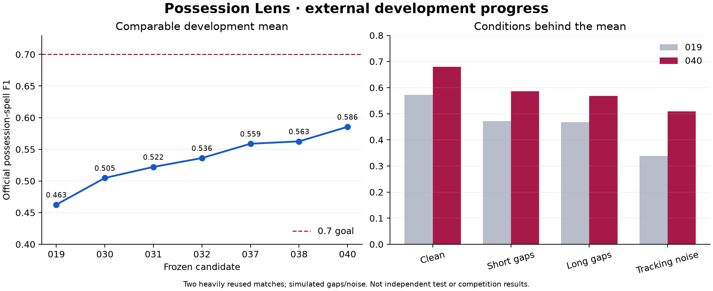

# Joint-motion candidate040

040 combines the relative-motion416-feature representation with ball-independent collective shape and selected collective dynamic supports, producing508features. Team-side direction is inferred from half-wide extreme-player team votes; no manual side or identity mapping is used.100- and200-tree variants use the same labels, spell weights, four augmentations and seed132 as032. The context RNN, quality/dead models, boundary head and decoder remain frozen.

| Reused external condition | Reference037 spell F1 |040 spell F1 |
|---|---:|---:|
| clean | 0.6748 | 0.6802 |
| masked | 0.5542 | 0.5858 |
| long_gap | 0.5296 | 0.5680 |
| tracker_noise | 0.4767 | 0.5084 |

Four-condition means:0370.558833; joint1000.583619; selected joint2000.585574. Repeated-condition misses1996→1870, false positives997→1007, geometric merges451→431.278 spell instances are newly recovered,152 previously matched instances lost. Short predictions under0.4s rise18→21. These counts repeat physical possessions across stress conditions; no independent sample-size claim.

All predeclared guards pass. After freezing, different observation draws on the same matches improve0.553212→0.588338 versus037.040 also improves every original condition in both folds versus038; its mean is0.585574 versus0380.562563. This comparison is a further reused-development diagnostic, not independent testing. Exact native saved-weight replay and two-environment full CSV reproduction are published.

The chart compares the same original external draws across versions. Its0.7line is a goal, not an achieved score. No competition percentile or challenge accuracy is measured. Both Bundesliga matches are heavily reused. Separate034 partial SkillCorner-provider results around0.31 expose domain-transfer risk and are not pooled with these fully labelled H/A/D results.

039's multi-source weak-live dead model fails: blends0.25/0.5 score0.557487/0.556615 versus0370.558833 and fail noise guards. Those weak team-possession groups are not verified stoppage truth; the model is not deployed.041's best narrow-event variant scores0.588951 versus0400.585574 but fails a noise-fold guard; no041 candidate/audit is selected. Full rejected trials are retained.

042 capacity,043 richer-motion64unit GRU and044 latent gap hypotheses are pending. None changes the frozen040 release.044 keeps inferred ball locations separate from actual observations and never passes them to dead-ball experts. All fitting and selection remains external; no challenge video, ground truth or public score is used. Current040 inference requires NumPy/pandas only.
