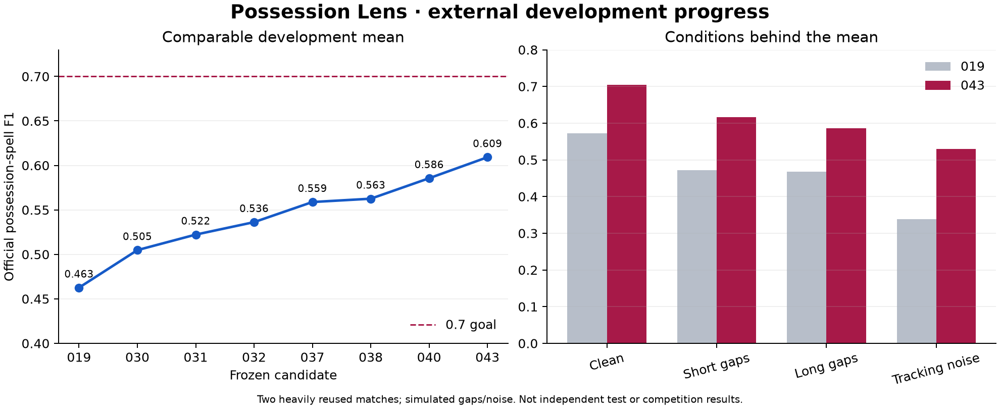

# Motion-feature bidirectional GRU043

043 trains a new recurrent conditional-control model from scratch on the same external first-division training match in each direction. The508 features combine relative ball/player movement and ball-independent collective shape/motion. A learned64-dimensional projection, LayerNorm/GELU and two bidirectional64-unit GRU layers use locked dropout0.25, output LayerNorm, Xavier input/output and orthogonal recurrent gates. It trains24 fixed iterations of512 windows, AdamWlr0.0005/weightdecay0.001 and gradient norm clipping1.

Training/inference use matching256-frame cores with64 context frames each side. Known-live H/A spell-weighted CE excludes dead/unknown/context/padding. An auxiliary narrow turnover target (+-2frames, fully known-live +-12 neighbourhood) adds boundary BCE0.1; it is a representation objective, not a reported event likelihood. No previous possession label is an input. Mean/scale fit training observations only. All input augmentations and team swaps remain unchanged.

The selected conditional-live mixture is50%newGRU+50%complete040 control. Thus it includes50%GRU,37.5%040tree and12.5%oldcontextRNN. Original dead/quality experts and031 boundary-aware decoder remain unchanged. The GRU's unusedD logit is excluded from conditional-live normalisation.

| Reused external condition |040 spell F1 |043 spell F1 |
|---|---:|---:|
| clean | 0.6802 | 0.7051 |
| masked | 0.5858 | 0.6162 |
| long_gap | 0.5680 | 0.5856 |
| tracker_noise | 0.5084 | 0.5299 |

Means:0400.585574;25%GRU0.600225; selected50%GRU0.609188; pureGRU0.601318. Repeated-condition misses1870→1777, false positives1007→925, merges431→425, short predicted pulses21→13.169 spell instances are newly recovered and76 previously matched instances are lost. Counts repeat physical possessions across conditions.

After freezing, different observation draws score0.584200→0.599036. These are the same two heavily reused games, not independent-match testing. All16 saved external predictions replay exactly. Two source/dependency environments reproduce the complete CSV identically on the same machine. NumPy/pandas/PyTorch2.9.1 are pinned; CPU inference uses1Torchthread and deterministic algorithms, without a GPU or network request.

042's stronger regularised tree scores0.593924 and passes its audit0.580863→0.589032, but is below043.044's separate long-gap linear hypotheses score0.586433 versus0400.585574 and fail minimum gain/noise guards.045 fusion fails: best0.612481 regresses a noise fold.046 extraCE0.610258 and focal0.611396 fail minimum gain; focal reduces false positives but misses more spells.047 masked-ball auxiliary training fails, best0.587723.048 penalties6/9 score0.610380/0.611616 and fail minimum-gain/noise guards. None changes043.050 field-reflection averaging fails the minimum gain; best mirrorY0.610756 versus0430.609188. The052 seven-match transfer comparison is still running. Partial-provider034 diagnostics remain a separate weaker result and expose transfer risk. No challenge video, possession truth or public score enters training/selection, and no competition percentile or0.7mean is established.

Final checkpoint052: see docs/external/TRANSFER_052.md and reports/external/transfer-052-report.json.043 remains preserved.
